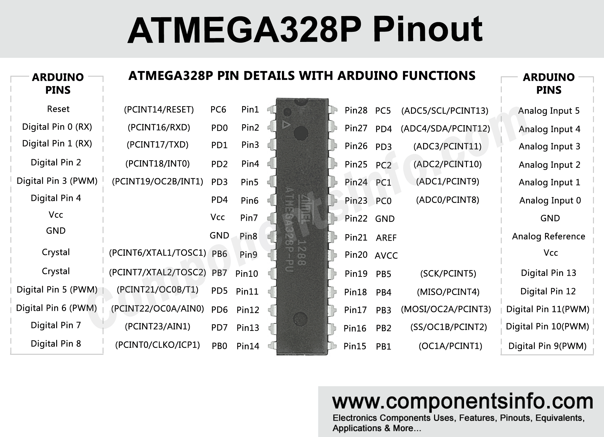

# Line following bot Notes

## Building

### Requirements

* `avrdude`
* AVR toolchain `avr-gcc`, `avr-libc`, `avr-objcopy`, etc.
* GNU Make

To compile, run `make` to produce the ihex file of the program.
`make flash` uses AVRDude to flash to the target chip using a USBASP
device.

On Windows systems using MSYS2, `mingw32-make` is used over `make`.

### Programming without an usbasp

Override the `AVRDUDE_ARGS` variable to include `-c arduino`. Below is an
example for programming on windows

```sh
mingw32-make flash AVRDUDE_ARGS="-c arduino -P ch340"
```

## Pin assignments

| Module | Function | Pin (m328p) | Physical Pin# (m328p) |
| ------ | -------- | ----------- | ------------- |
| Motor Driver | PWM | PB1 | 15 |
| Motor Driver | Direction | PC[0..3] | 23 to 26 |
| Motor Driver | Standby | PC4 | 27 |
| IR Array | Array Input | PD[0..7] | 2 to 6, 11 to 13 |

## Microcontroller Pinout


