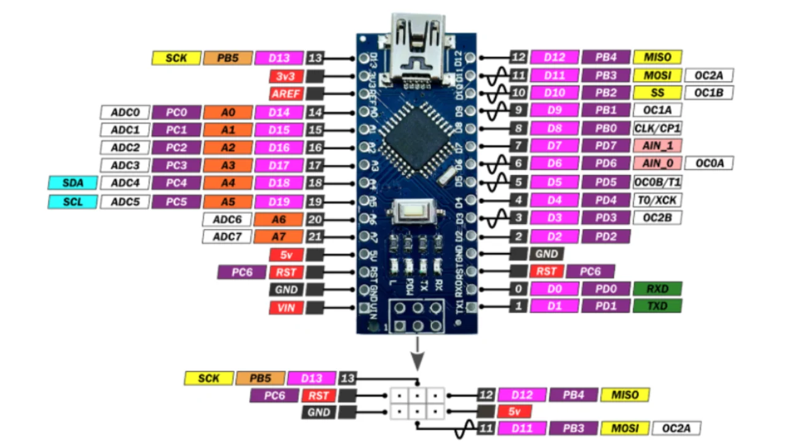

# Line following bot Notes

## Building

### Requirements

* `avrdude`
* AVR toolchain `avr-gcc`, `avr-libc`, `avr-objcopy`, etc.
* GNU Make

To compile, run `make` to produce the ihex file of the program.
`make flash` uses AVRDude to flash to the target chip using a USBASP
device.

On Windows systems using MSYS2, `mingw-make` is used over `make`.

## Pin assignments

| Module | Function | Pin (m328p) | Physical Pin# (m328p) |
| ------ | -------- | ----------- | ------------- |
| Motor Driver | PWM | PD3 | D3 |
| Motor Driver | Direction | PC[0..3] | D[14..17] / A[0..3] |
| Motor Driver | Standby | PB4 | D12 |
| IR Array | Array Input | PD[4..7] (low byte), PB[0..3] (high byte) | D[4..7], D[8..11] |

## Nano Pinout

